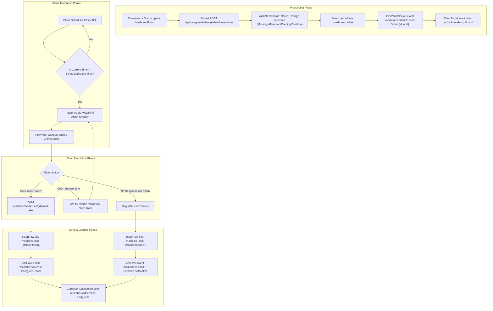
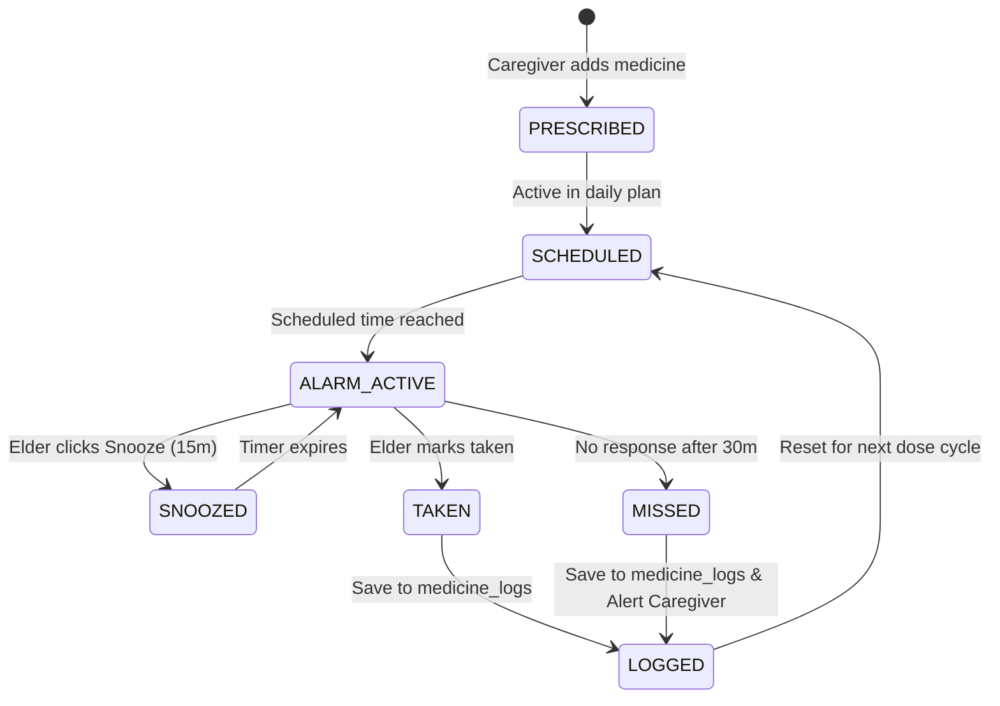
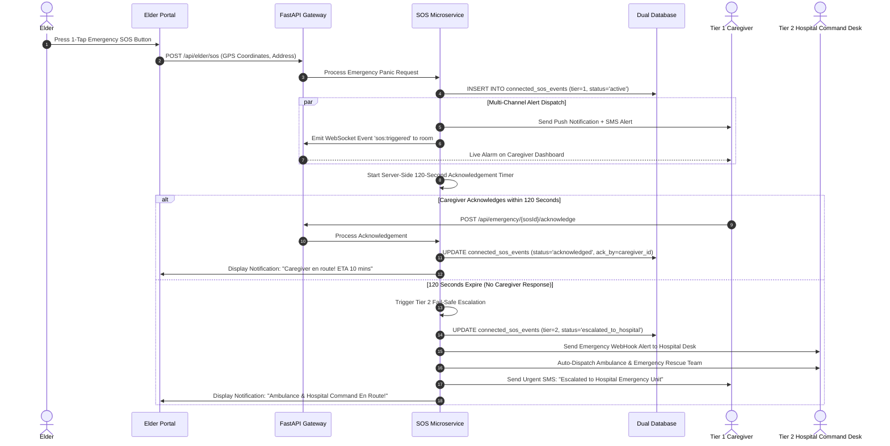
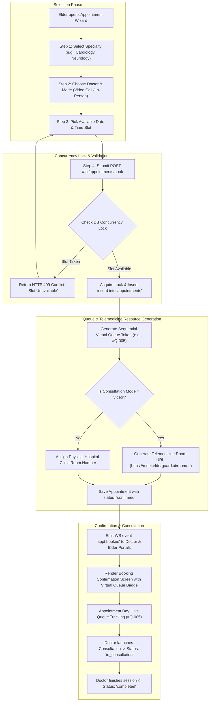
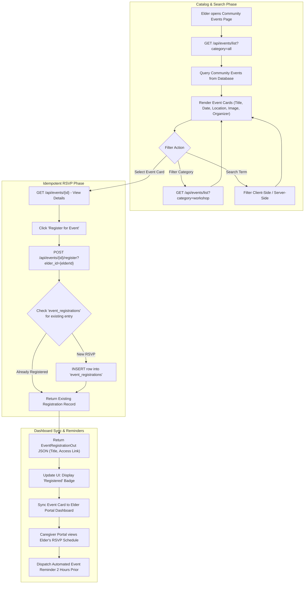
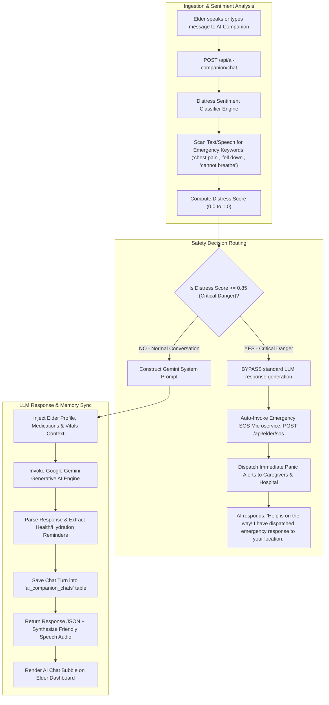

# ElderGuard AI — Microservices User Flow, Tech Stack & System Architecture Specifications

**Project Title:** ElderGuard AI — Multi-Tier Senior Health Care & Emergency Escalation Platform  
**Repository Path:** `c:\LOKI\Elder_guard`  
**File Location:** `c:\LOKI\Elder_guard\Microservices_User_Flow_System_Design.md`  
**Date:** August 13, 2026  
**Document Version:** 1.0.0  

---

## Executive Summary

This document provides a comprehensive technical blueprint, technology stack matrix, system design pattern reference, and granular **Mermaid user flow diagrams** for the five core microservices of the **ElderGuard AI** platform:

1. 💊 **Medicine Reminder Microservice**
2. 🚨 **SOS Emergency Alerts & Multi-Tier Escalation Microservice**
3. 📅 **Appointment Booking & Virtual Queue Microservice**
4. 🎨 **Community Events for Elders Microservice**
5. 🤖 **AI Companion & Distress Sentiment Classifier Microservice**

---

## 1. Technology Stack Matrix

| Architectural Layer | Technologies Used | Key Selection Rationale |
| :--- | :--- | :--- |
| **Frontend UI Framework** | **React 18 + Vite 5** | High-performance Single Page Application (SPA), lightning-fast Hot Module Replacement (HMR), component-driven UI lifecycle. |
| **Styling & Accessibility Theme** | **Vanilla CSS + Tailwind CSS** | Custom CSS design tokens combined with utility classes for ultra-high contrast, large typography, and accessible senior UI components. |
| **Icons & Visual Analytics** | **Lucide React + Recharts** | Scalable vector iconography and responsive health vitals telemetry charting. |
| **Client State Management** | **TanStack Query v5 (React Query)** | Automatic request deduplication, cache invalidation on WebSocket events, background refetching, and optimistic UI mutations. |
| **Cross-Tab Realtime Bus** | **Web BroadcastChannel API** | Zero-latency cross-tab communication across open role portals (Elder, Caregiver, Doctor) without network overhead. |
| **Backend API Gateway & Framework** | **FastAPI (Python 3.11) + Uvicorn** | Asynchronous ASGI request handling, high throughput, automatic OpenAPI/Swagger documentation schema generation. |
| **Data Validation & ORM** | **Pydantic v2 + SQLAlchemy 2.0** | Strict static type enforcement, JSON schema serialization, and raw SQL query execution capabilities. |
| **Cloud Primary Database** | **Supabase Cloud PostgreSQL** | Managed PostgreSQL with Row-Level Security (RLS) policies for strict tenant & role isolation. |
| **Local Fallback Database Engine** | **SQLite / Local PostgreSQL (`elderguard.db`)** | Zero-dependency local file database providing offline resiliency during network degradation. |
| **Realtime Event Streaming** | **Server-Sent Events (SSE) + WebSockets** | Persistent HTTP streaming rooms (`elder:{elderId}`) for live bi-directional alarm and alert dispatching. |
| **AI Intelligence Engine** | **Google Gemini Generative AI** | Conversational companion empathy model and real-time acoustic/textual distress sentiment classifier. |
| **OCR Image Extraction** | **Tesseract / Vision AI Model** | Optical Character Recognition parsing prescription images into structured digital dose schedules. |
| **Test Suite & Tooling** | **Pytest + Node.js npm** | Integration testing for connected portals, RBAC access controls, and WebSocket event broadcasts. |

---

## 2. System Design Architecture & Key Technical Concepts

### 2.1 Core Architectural Patterns Used
1. **Service-Oriented Microservices Architecture (SOA):** Decoupled domain services (`/medicines`, `/emergency`, `/appointments`, `/events`, `/ai-companion`) with distinct business logic, data boundaries, and API schemas.
2. **API Gateway & Middleware Pattern:** Central FastAPI Router handling CORS, JWT Bearer Token validation, Role-Based Access Control (RBAC), and global error handling.
3. **Dual-Database Resilience Strategy:** Automatic fallback pattern where database queries attempt Cloud Supabase execution first, gracefully failing over to the local engine (`elderguard.db` / local Postgres) if cloud connectivity is degraded.
4. **Pub/Sub Event Broadcast Bus:** Room-based SSE & WebSocket subscription channels (`elder:{elder_id}`) ensuring instant state sync across Elder, Caregiver, Doctor, and Hospital portals upon database mutations.
5. **Idempotent Mutation Pattern:** Guarantees duplicate API requests (e.g., event registration, dose logging) result in identical system state without duplicate records.

### 2.2 Domain Technical Glossary
- **Virtual Queue Token (`#Q-xxx`):** Deterministic sequential token assigned upon appointment booking for clinic queue management.
- **120-Second Tiered Escalation:** Automatic countdown timer routing panic alerts from Tier 1 family caregivers to Tier 2 Hospital Command Desks if unacknowledged within 2 minutes.
- **Adherence Digest Ledger (`medicine_logs`):** Continuous transaction log calculating medication compliance percentages over time.
- **Distress Sentiment Classifier:** Natural Language Processing (NLP) module analyzing text/speech for emergency phrases (`chest pain`, `cannot breathe`, `fell down`).

---

## 3. High-Level Master Microservices System Architecture

```mermaid
graph TD
    subgraph Client Layer ["Client Applications & Role Portals"]
        EP["Elder Portal (SPA)"]
        CP["Caregiver Portal (SPA)"]
        DP["Doctor Portal (SPA)"]
        HP["Hospital Command Portal"]
        BC["Client Event Bus (BroadcastChannel)"]
    end

    subgraph Gateway ["FastAPI Core API Gateway & Router"]
        GW["API Gateway & Reverse Proxy"]
        JWT["JWT Auth & RBAC Middleware"]
        SSE_HUB["SSE & WebSocket Room Manager ('elder:{id}')"]
    end

    subgraph Microservices ["Business Services Engine"]
        SVC_MED["1. Medicine Reminder Microservice"]
        SVC_SOS["2. SOS Emergency Alerts Microservice"]
        SVC_APPT["3. Appointment Booking Microservice"]
        SVC_EVT["4. Community Events Microservice"]
        SVC_AI["5. AI Companion Microservice"]
        SVC_NOTIF["Notification Dispatch Hub (SMS / Push)"]
    end

    subgraph Persistence ["Dual-Database Layer"]
        DB_SUPA[("Cloud Supabase PostgreSQL")]
        DB_LOCAL[("Local SQLite / Postgres Fallback")]
    end

    EP <--> BC
    CP <--> BC
    DP <--> BC
    HP <--> BC

    Client Layer <-->|"HTTPS / REST & WebSockets"| GW
    GW --> JWT
    GW --> SSE_HUB
    JWT --> Microservices

    SVC_MED --> Persistence
    SVC_SOS --> Persistence
    SVC_APPT --> Persistence
    SVC_EVT --> Persistence
    SVC_AI --> Persistence

    SVC_MED -.->|"Event: medicine:taken"| SSE_HUB
    SVC_SOS -.->|"Event: sos:triggered"| SSE_HUB
    SVC_APPT -.->|"Event: appt:booked"| SSE_HUB
    SVC_EVT -.->|"Event: event:registered"| SSE_HUB
    
    SVC_AI -.->|"Distress Detected"| SVC_SOS
    Services --> SVC_NOTIF
```

---

## 4. Detailed Microservice User Flow Diagrams & System Designs

---

### 4.1 Microservice 1: Medicine Reminder Engine

#### Technical Overview
Manages medication schedules, daily dose reminders, pill alarm audio-visual triggers, and caregiver compliance tracking.
- **Primary Routes:** `GET /api/elder/medicines`, `POST /api/caregiver/elders/{elderId}/medicines`, `POST /api/elder/medicines/{id}/mark-taken`
- **Key Tables:** `medicines`, `medicine_logs`

#### User Flow Diagram (Mermaid)



#### State Transition Machine


---

### 4.2 Microservice 2: SOS Emergency Alerts & Multi-Tier Escalation

#### Technical Overview
Handles 1-tap panic triggers, location gathering, multi-channel family notifications, server-side 120s timer tracking, and Tier 2 hospital command desk escalation.
- **Primary Routes:** `POST /api/elder/sos`, `POST /api/emergency/{sosId}/acknowledge`
- **Key Tables:** `connected_sos_events`

#### User Flow Diagram (Mermaid)



---

### 4.3 Microservice 3: Appointment Booking & Virtual Queue Microservice

#### Technical Overview
Provides conflict-free doctor scheduling, double-booking prevention via DB locks, sequential virtual queue token generation (`#Q-001`), and telemedicine video room creation.
- **Primary Routes:** `GET /api/appointments/doctors`, `POST /api/appointments/book`
- **Key Tables:** `appointments`, `doctors`

#### User Flow Diagram (Mermaid)



---

### 4.4 Microservice 4: Community Events for Elders Microservice

#### Technical Overview
Facilitates social engagement, virtual workshops, health camps, and travel expeditions to reduce isolation among senior citizens.
- **Primary Routes:** `GET /api/events/list`, `POST /api/events/{id}/register`
- **Key Tables:** `community_events`, `event_registrations`

#### User Flow Diagram (Mermaid)



---

### 4.5 Microservice 5: AI Companion & Distress Sentiment Classifier

#### Technical Overview
Combines Google Gemini Generative AI for empathetic senior conversation with a real-time distress sentiment classifier scanning voice/text inputs for emergency keywords.
- **Primary Routes:** `POST /api/ai-companion/chat`
- **Key Tables:** `ai_companion_chats`

#### User Flow Diagram (Mermaid)



---

## 5. Master All-Microservices Interconnected Flowchart

This master diagram details how all 5 microservices communicate with each other, the API Gateway, and the persistence layer:

```mermaid
flowchart TD
    Start (["Elder logs into ElderGuard AI Portal"]) --> MainDash["Elder Dashboard Navigation Hub"]
    
    MainDash --> Choice{"Select Feature Area"}

    %% 1. Medicine Reminder Service
    Choice -->|1. Medicine Schedule| M1["View Daily Medication Schedule"]
    M1 --> M1_Alarm{"Dose Time Reached?"}
    M1_Alarm -->|Yes| M1_Chime["Trigger Audio-Visual Pill Alarm"]
    M1_Chime --> M1_Resp{"Elder Choice"}
    M1_Resp -->|Mark Taken| M1_Taken["Log 'taken' -> Emit WS 'medicine:taken'"]
    M1_Resp -->|Missed| M1_Missed["Log 'missed' after 30m -> SMS Caregiver Alert"]
    M1_Taken --> MainDash
    M1_Missed --> MainDash

    %% 2. Emergency SOS Service
    Choice -->|2. SOS Panic| M2["Tap 1-Tap Emergency SOS Button"]
    M2 --> M2_Trigger["POST /api/elder/sos"]
    M2_Trigger --> M2_Tier1["Send Push/SMS/WS to Tier 1 Caregivers"]
    M2_Tier1 --> M2_Timer{"Caregiver Ack < 120s?"}
    M2_Timer -->|Yes| M2_Ack["Caregiver En Route -> Notify Elder"]
    M2_Timer -->|No| M2_Tier2["Auto-Escalate Tier 2: Hospital & Ambulance Dispatch"]
    M2_Ack --> MainDash
    M2_Tier2 --> MainDash

    %% 3. Appointment Booking Service
    Choice -->|3. Appointments| M3["4-Step Appointment Booking Wizard"]
    M3 --> M3_Select["Select Doctor, Date & Time Slot"]
    M3_Select --> M3_Lock{"Slot Available?"}
    M3_Lock -->|Yes| M3_Confirm["Book Slot + Assign Token #Q-001 + Generate Video Link"]
    M3_Lock -->|No| M3_Select
    M3_Confirm --> M3_Consult["Appt Day: Telemedicine Consultation"]
    M3_Consult --> MainDash

    %% 4. Community Events Service
    Choice -->|4. Community Events| M4["Browse Senior Social & Wellness Catalog"]
    M4 --> M4_Filter["Filter Workshop / Travel / Health Camp"]
    M4_Filter --> M4_Reg["POST /api/events/{id}/register (Idempotent)"]
    M4_Reg --> M4_Sync["Sync Card to Dashboard & Send 2h Reminder"]
    M4_Sync --> MainDash

    %% 5. AI Companion Service
    Choice -->|5. AI Companion| M5["Talk / Type to Gemini AI Companion"]
    M5 --> M5_Scan["Distress Sentiment Classifier"]
    M5_Scan --> M5_Check{"Distress Score >= 0.85?"}
    M5_Check -->|Normal| M5_Gemini["Gemini LLM Response + Medication Memory"]
    M5_Check -->|Critical| M5_AutoSOS["AUTO-TRIGGER SOS Microservice"]
    M5_Gemini --> MainDash
    M5_AutoSOS --> M2_Trigger
```

---

## 6. Summary Matrix of Microservice Endpoints & Data Schemas

| Microservice | Primary API Route | Key HTTP Method | Data Schema / Tables | Main Tech Component |
| :--- | :--- | :--- | :--- | :--- |
| **1. Medicine Reminder** | `/api/elder/medicines` | `GET`, `POST` | `medicines`, `medicine_logs` | Client Scheduler + WebSocket `medicine:taken` |
| **2. SOS Emergency Alerts** | `/api/elder/sos` | `POST` | `connected_sos_events` | 120s Timer + WebHook Ambulance Dispatch |
| **3. Appointment Booking** | `/api/appointments/book` | `GET`, `POST` | `appointments`, `doctors` | DB Concurrency Lock + `#Q-xxx` Token Gen |
| **4. Community Events** | `/api/events/list` | `GET`, `POST` | `community_events`, `event_registrations` | Idempotent Registration + Calendar Sync |
| **5. AI Companion** | `/api/ai-companion/chat` | `POST` | `ai_companion_chats` | Gemini Generative LLM + Distress Classifier |

