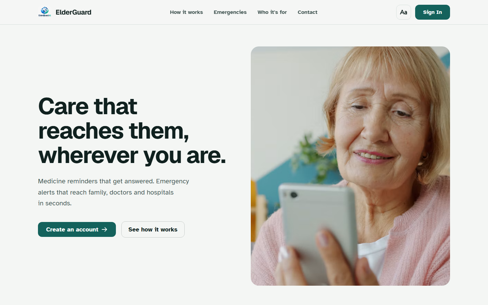
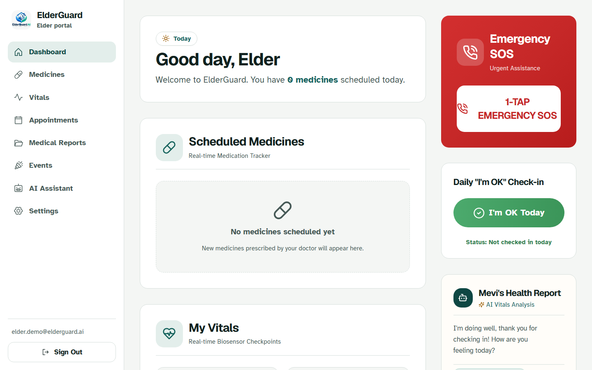
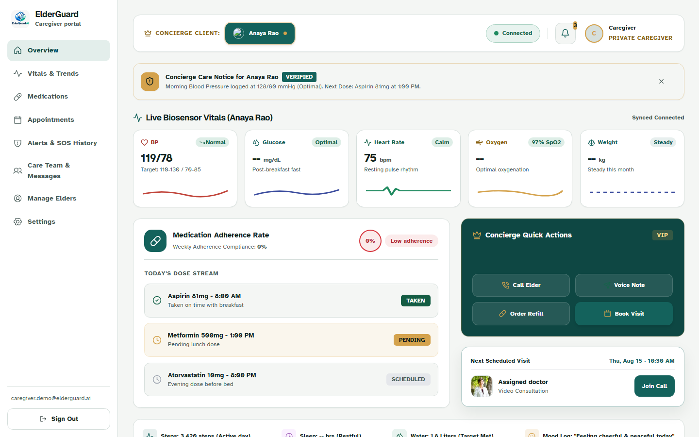
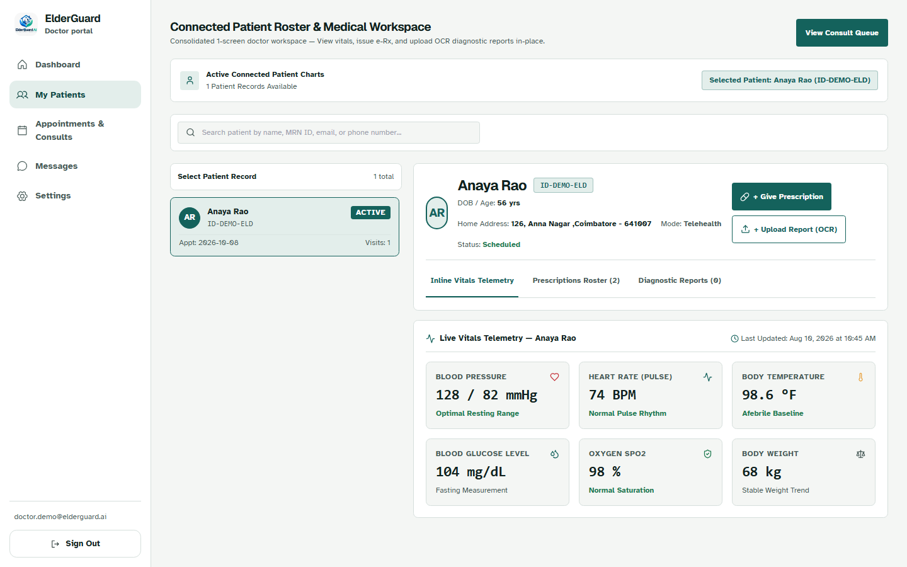
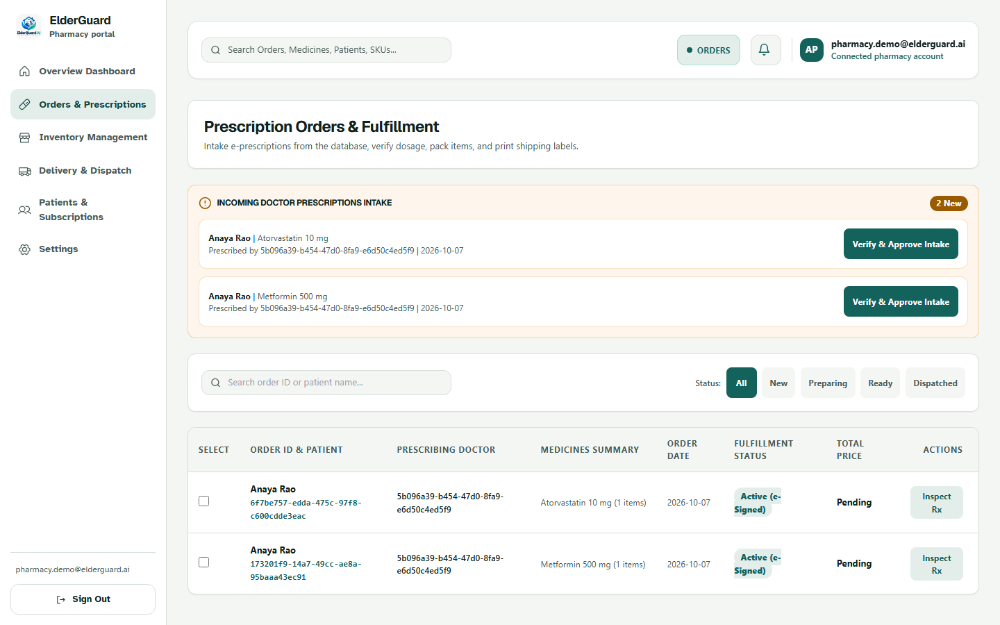

# ElderGuard AI

**Care that reaches them, wherever you are.**

ElderGuard is a connected care app for older adults and the people around them. An elder, their family caregiver, their doctor, a pharmacy and a hospital all work from the same live record, each through a portal built for what they actually need to do.

We built it as our mini project at SNS College of Technology, Coimbatore (course 23ITP202, Mini Project I).



## Why we built it

Many older people live apart from their families. A missed morning tablet, a blood pressure reading nobody logged, a fall at night: each of these is small until it isn't. The people who could help usually hold only one piece of the picture. The daughter doesn't know if the tablet was taken, the doctor never sees the readings, and the pharmacy gets a paper slip.

ElderGuard puts all of that in one place and makes the most important actions very hard to get wrong.

## What it does

- **Medicine reminders that get answered.** The alarm keeps ringing until the elder taps *Medicine Taken*, and the caregiver sees the dose logged live.
- **One-tap SOS with escalation.** The caregiver is alerted straight away. If nobody acknowledges it, it moves on to a second contact (2 min), the hospital (5 min) and emergency services (10 min).
- **Vitals tracking.** Blood pressure, sugar, oxygen, heart rate and weight, with target ranges and trend charts.
- **Doctor to pharmacy, no paper.** A doctor writes an e-prescription for a named pharmacy and it appears in that pharmacy's intake queue.
- **Telemedicine queue.** Appointments with queue tokens and a consult desk.
- **Mevi, an AI companion.** A friendly chat that knows the elder's own medicines and vitals. It explains things in plain language and does not diagnose.
- **Five portals, one record.** Elder, Caregiver, Doctor, Hospital and Pharmacy, with role-based access.
- **Built for older eyes.** Extra-large text in the elder portal, big touch targets, a text-size control, and checks against WCAG 2.1 A/AA.

| Elder | Caregiver |
| --- | --- |
|  |  |
| **Doctor** | **Pharmacy** |
|  |  |

## How it fits together

```
React 18 + Vite + Tailwind  (five portals)
        |  REST + WebSocket
FastAPI  --  APScheduler (reminders, SOS escalation)  --  Groq LLM (Mevi)
        |
SQLite (local)  or  Supabase / PostgreSQL (hosted)
        |
Notifications: in-app, Firebase push, Telegram
```

The escalation runs as a background job on the server, so it does not depend on anyone having a screen open. For the details of how elder and caregiver data stay in sync, see [docs/connected-data-flow.md](docs/connected-data-flow.md).

## Installation

### What you need

- Node.js 20 or newer
- Python 3.11 or newer (we developed on 3.13)
- Git
- Optional: a Groq API key for the AI companion, and Docker if you want a local PostgreSQL

### 1. Get the code

```bash
git clone https://github.com/Lokesh848-code/Elder_guard.git
cd Elder_guard
```

### 2. Backend

```bash
cd backend
python -m venv venv
```

Activate it (`venv\Scripts\activate` on Windows, `source venv/bin/activate` on macOS and Linux), then:

```bash
pip install -r requirements.txt
cp .env.example .env
```

Open `backend/.env` and set at least `JWT_SECRET` to any long random string. If you leave the database settings alone, the app uses a local SQLite file (`backend/elderguard.db`), so you don't need to set up a database to try it. Add `GROQ_API_KEYS` if you want Mevi to answer.

### 3. Frontend

```bash
cd ../frontend
npm install
```

### 4. Load the demo data

From the `backend` folder with the virtual environment active:

```bash
python seed_connected_demo.py
```

This creates five demo accounts and a small connected story: an elder with medicines, her caregiver, a doctor with a telemedicine appointment, two prescriptions addressed to a pharmacy, plus the hospital and pharmacy accounts.

### 5. Run it

On Windows, from the repository root, one command starts both servers:

```bash
npm install
npm run dev
```

On macOS or Linux, open two terminals:

```bash
# terminal 1, in backend/
uvicorn app.main:app --reload --port 8000

# terminal 2, in frontend/
npm run dev
```

Then open <http://localhost:5173>. The API docs are at <http://localhost:8000/docs>.

### Demo accounts

All five use the password `DemoPass123!`. It is demo data only, so never reuse it anywhere real.

| Role | Email |
| --- | --- |
| Elder | elder.demo@elderguard.ai |
| Caregiver | caregiver.demo@elderguard.ai |
| Doctor | doctor.demo@elderguard.ai |
| Hospital | hospital.demo@elderguard.ai |
| Pharmacy | pharmacy.demo@elderguard.ai |

### Showing the SOS escalation quickly

The real timings are 2, 5 and 10 minutes, which is a long time to wait during a demo. On Windows you can run:

```bash
npm run dev:demo
```

That sets `SOS_DEMO_SECONDS=15`, so the tiers fire 15 seconds apart. On other systems set the variable `SOS_DEMO_SECONDS=15` before starting the backend. Leave it at `0` for the real timings.

### Optional: PostgreSQL or Supabase

- Local PostgreSQL: run `docker compose up -d`, then fill in the `LOCAL_POSTGRES_*` values in `backend/.env`.
- Supabase: set `SUPABASE_URL` and `SUPABASE_KEY`, and apply the SQL files in `backend/supabase/migrations`.

## Running the tests

With both servers running and the demo data loaded:

```bash
cd frontend
npx playwright install chromium     # first time only
npm run test:e2e                    # every portal page, the demo story, wrong password
npm run test:a11y                   # axe accessibility scan, WCAG 2.1 A/AA
npm run test:mobile                 # phone-size layout
```

Backend checks live in `backend/test_*.py`, for example `pytest test_connected_portals.py`.

## Project layout

```
backend/            FastAPI app (app/), seed scripts, tests, SQL migrations
frontend/           React app (src/pages per portal, src/components, src/services)
frontend/tests/     Playwright end-to-end and accessibility tests
docs/presentation/  Project presentation (PDF, PPTX and the scripts that build them)
docs/report/        Mini project report (DOCX, PDF) and its build scripts
docs/screenshots/   Images used in this README
```

## Known limits

We would rather be upfront about what this prototype does not do yet:

- Alerts go out in the app, by push and by Telegram. There is **no SMS or voice-call provider** yet.
- The hospital SOS desk receives live alerts through a same-browser broadcast. A real server push to hospitals is not built.
- Pharmacy order status changes (verify, prepare, dispatch) are kept in the browser only.
- The prescription scanner screen is a prototype without a production OCR service.
- Everything has been tested on demo data. No real elders have used it yet.
- ElderGuard alerts and informs. It does not diagnose and it does not replace a doctor or emergency services.

## What's next

**Soon**
- SMS and voice-call alerts with delivery receipts and retries
- Server-side push to the hospital desk and a durable job queue for escalation
- Verified doctor and hospital accounts, plus consent and audit logging

**After that**
- Multilingual voice assistant (Tamil, Hindi and more)
- Installable mobile app with offline mode and an always-ready SOS button

**Later**
- Smartwatch integration for heart rate, blood pressure and fall detection
- Health record exchange with ABHA / ABDM, with the elder's consent

**Before any of it matters**
- Sit down with real elders and caregivers, watch them use it, and fix what confuses them
- A small pilot with a clinic or care home

## Contributing

Issues and pull requests are welcome. If you plan something larger than a bug fix, open an issue first so we can talk it through. Please run the Playwright tests before sending a pull request.

## Team

Dinesh N, Bhoopesh M and Dharshan V, with Ms. K. Revathi (Department of AI & DS) as our guide.

## License

Released under the [MIT License](LICENSE).
