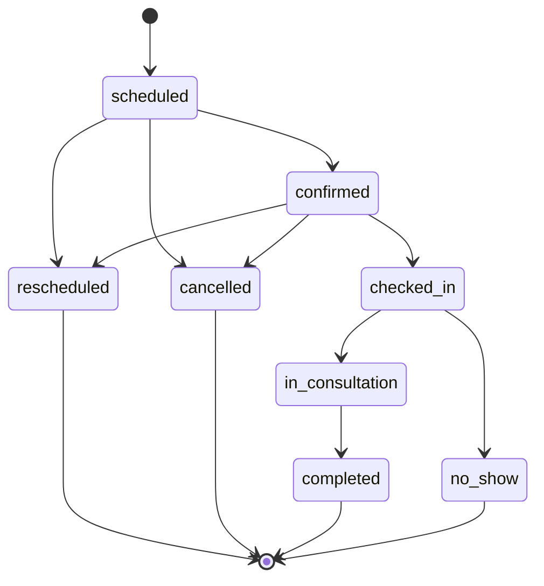
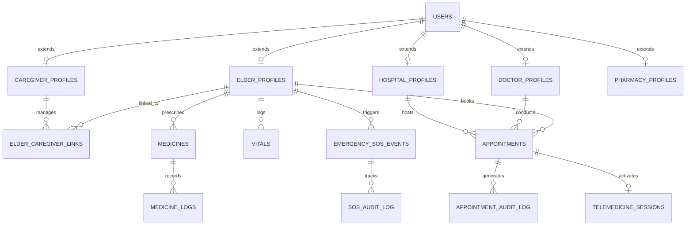

# ElderGuard AI: Comprehensive Technical & System Architecture Report

**Project Title:** ElderGuard AI — Intelligent Multi-Tier Senior Health Care & Emergency Escalation Platform  
**Repository Path:** `c:\LOKI\Elder_guard`  
**Date of Report:** August 10, 2026  
**Document Version:** 1.0.0  
**Author:** Antigravity AI Engineering Team  

---

## Table of Contents

1. [Executive Summary](#1-executive-summary)
   - [1.1 Mission & Overview](#11-mission--overview)
   - [1.2 Key Platform Capabilities](#12-key-platform-capabilities)
2. [System Architecture & Technology Stack](#2-system-architecture--technology-stack)
   - [2.1 High-Level Architecture Topology](#21-high-level-architecture-topology)
   - [2.2 Technology Stack Matrix](#22-technology-stack-matrix)
3. [Role-Based Portals & User Experience](#3-role-based-portals--user-experience)
   - [3.1 Elder Portal](#31-elder-portal)
   - [3.2 Caregiver Portal](#32-caregiver-portal)
   - [3.3 Doctor Portal](#33-doctor-portal)
   - [3.4 Hospital Portal](#34-hospital-portal)
   - [3.5 Pharmacy Portal](#35-pharmacy-portal)
4. [Backend Microservices Architecture](#4-backend-microservices-architecture)
   - [4.1 Authentication & Security Service](#41-authentication--security-service)
   - [4.2 User & Profile Management Service](#42-user--profile-management-service)
   - [4.3 Appointments & Availability Microservice](#43-appointments--availability-microservice)
   - [4.4 Emergency SOS & Multi-Tier Escalation Service](#44-emergency-sos--multi-tier-escalation-service)
   - [4.5 Health Vitals & Anomaly Ingestion Engine](#45-health-vitals--anomaly-ingestion-engine)
   - [4.6 Smart Medication & Pill Alarm Engine](#46-smart-medication--pill-alarm-engine)
   - [4.7 AI Companion & Distress Sentiment Classifier](#47-ai-companion--distress-sentiment-classifier)
   - [4.8 Medical Report OCR & Document Parsing Engine](#48-medical-report-ocr--document-parsing-engine)
   - [4.9 Multi-Channel Notification Dispatch Hub](#49-multi-channel-notification-dispatch-hub)
5. [Complete API Endpoints & Request/Response Contracts](#5-complete-api-endpoints--requestresponse-contracts)
   - [5.1 Authentication API (`/auth`)](#51-authentication-api-auth)
   - [5.2 Profile Management API (`/profiles`)](#52-profile-management-api-profiles)
   - [5.3 Appointments Microservice API (`/appointments`)](#53-appointments-microservice-api-appointments)
   - [5.4 Emergency SOS API (`/emergency`)](#54-emergency-sos-api-emergency)
   - [5.5 Health Vitals API (`/vitals`)](#55-health-vitals-api-vitals)
   - [5.6 Medication Schedule API (`/medicines`)](#56-medication-schedule-api-medicines)
   - [5.7 AI Companion API (`/ai-companion`)](#57-ai-companion-api-ai-companion)
   - [5.8 Prescription OCR API (`/ocr`)](#58-prescription-ocr-api-ocr)
6. [Database Schema & Data Architecture](#6-database-schema--data-architecture)
   - [6.1 Entity-Relationship Model](#61-entity-relationship-model)
   - [6.2 Dual-Database Persistence Strategy](#62-dual-database-persistence-strategy)
   - [6.3 Complete SQL Table Specifications](#63-complete-sql-table-specifications)
7. [Real-time Event Synchronization Bus](#7-real-time-event-synchronization-bus)
   - [7.1 Client-Side BroadcastChannel & CustomEvent Bus](#71-client-side-broadcastchannel--customevent-bus)
   - [7.2 Server-Sent Events (SSE) Room Manager](#72-server-sent-events-sse-room-manager)
8. [Security, RBAC Matrix & Compliance](#8-security-rbac-matrix--compliance)
   - [8.1 Role-Based Access Control (RBAC) Matrix](#81-role-based-access-control-rbac-matrix)
   - [8.2 Data Privacy & Encryption Standards](#82-data-privacy--encryption-standards)
   - [8.3 Immutable Audit Logging](#83-immutable-audit-logging)
9. [Testing, Quality Assurance & Test Suite Outputs](#9-testing-quality-assurance--test-suite-outputs)
   - [9.1 Test Architecture & Coverage](#91-test-architecture--coverage)
   - [9.2 Appointments Test Execution Log](#92-appointments-test-execution-log)
   - [9.3 Emergency Escalation Test Execution Log](#93-emergency-escalation-test-execution-log)
   - [9.4 Vitals & Anomaly Test Log](#94-vitals--anomaly-test-log)
10. [Deployment & Operating Instructions](#10-deployment--operating-instructions)
    - [10.1 Backend FastAPI Deployment](#101-backend-fastapi-deployment)
    - [10.2 Frontend Production Build](#102-frontend-production-build)
11. [Conclusion & Future Strategic Roadmap](#11-conclusion--future-strategic-roadmap)

---

## 1. Executive Summary

### 1.1 Mission & Overview

**ElderGuard AI** is a comprehensive, multi-tiered health management, medical consultation, and emergency escalation platform engineered to address the challenges facing elderly care in home and clinical settings. 

Modern healthcare systems frequently suffer from fragmented communication between senior citizens, their informal family caregivers, primary care physicians, hospital emergency departments, and retail pharmacies. Seniors living independently often experience isolation, difficulty adhering to complex medication schedules, delays in emergency assistance, and technological barriers when operating digital health applications.

ElderGuard AI resolves these challenges by providing a unified healthcare network centered around the senior citizen. Built upon an accessible, high-contrast user interface and backed by an asynchronous FastAPI microservices architecture, ElderGuard AI connects seniors to their care network in real time.

### 1.2 Key Platform Capabilities

- **1-Tap Emergency SOS & Multi-Tier Escalation:** Immediate panic alert dispatch that notifies Tier 1 family caregivers first. If unacknowledged within 120 seconds, the system automatically escalates to Tier 2 (Hospital Command Desk & Ambulance Dispatch).
- **Senior-Centered Accessible Design System:** Ultra-high contrast color palettes, enlarged typography, clear iconography, and voice assistant integration tailored for seniors with visual, auditory, or motor impairments.
- **AI Companion & Sentiment Distress Classifier:** Powered by Google Gemini AI, providing conversational companionship, gentle medication reminders, and automated detection of acoustic or textual distress phrases.
- **Smart Appointment Engine & Virtual Queue Tokens:** Conflict-free doctor scheduling with double-booking prevention, telemedicine room generation, and automatic assignment of virtual queue tokens (e.g., `#Q-001`).
- **OCR Prescription Scanner & Schedule Converter:** Converts handwritten or printed prescription images into structured digital dosage schedules.
- **Dual-Database Resilience Architecture:** Operates seamlessly across Cloud Supabase PostgreSQL and local SQLite/PostgreSQL fallbacks to maintain uninterrupted operations during network degradation.

---

## 2. System Architecture & Technology Stack

### 2.1 High-Level Architecture Topology

ElderGuard AI implements a service-oriented architecture. The frontend is structured as a single-page application (SPA) built with React 18 and Vite, communicating via RESTful JSON APIs and Server-Sent Events (SSE) with a FastAPI backend server.

```mermaid
graph TD
    subgraph Client Layer [Portals & Event Bus]
        EP[Elder Portal]
        CP[Caregiver Portal]
        DP[Doctor Portal]
        HP[Hospital Portal]
        PP[Pharmacy Portal]
        BC[BroadcastChannel Realtime Bus]
    end

    subgraph Gateway & Middleware [FastAPI Core Gateway]
        GW[API Gateway & Router]
        AUTH[JWT Authentication & RBAC]
        SSE[Server-Sent Events Room Manager]
    end

    subgraph Microservices Layer [Business Services Engine]
        SVC_APPT[Appointments Microservice]
        SVC_SOS[Emergency SOS Escalation]
        SVC_VIT[Vitals & Anomaly Engine]
        SVC_MED[Medication & Alarm Engine]
        SVC_AIC[Gemini AI Companion]
        SVC_OCR[Prescription OCR Engine]
        SVC_NOTIF[Notification Dispatcher]
    end

    subgraph Persistence Layer [Dual-Database Strategy]
        DB_SUPA[(Supabase Cloud Postgres)]
        DB_LOCAL[(Local SQLite / Postgres)]
        CACHE[(In-Memory State Store)]
    end

    EP <--> BC
    CP <--> BC
    DP <--> BC
    HP <--> BC
    PP <--> BC

    Client Layer <-->|HTTPS / REST & SSE| GW
    GW --> AUTH
    GW --> SSE
    AUTH --> Microservices Layer

    SVC_APPT --> Persistence Layer
    SVC_SOS --> Persistence Layer
    SVC_VIT --> Persistence Layer
    SVC_MED --> Persistence Layer
    SVC_AIC --> Persistence Layer
    SVC_OCR --> Persistence Layer
    SVC_NOTIF --> Persistence Layer

    Microservices Layer <--> DB_SUPA
    Microservices Layer <--> DB_LOCAL
    Microservices Layer <--> CACHE
```

### 2.2 Technology Stack Matrix

| Layer / Component | Technology | Selection Rationale |
| :--- | :--- | :--- |
| **Frontend UI Framework** | React 18 + Vite 5 | Modular component lifecycle, sub-second HMR, high performance SPA bundle |
| **Styling & Theme Engine** | Vanilla CSS + Tailwind CSS | Flexible utility classes combined with custom CSS design tokens for accessibility |
| **Icons & Data Graphics** | Lucide React + Recharts | Scalable SVG icons and responsive health trend charting |
| **Client State Management** | TanStack Query v5 (React Query) | Automated caching, background refetching, and optimistic mutations |
| **Client Event Bus** | Web BroadcastChannel API | Zero-latency cross-tab communication across role portals without network latency |
| **Backend Framework** | FastAPI (Python 3.11) | Asynchronous ASGI request handling, automatic OpenAPI schema generation |
| **Data Validation & ORM** | Pydantic v2 + SQLAlchemy 2.0 | Strict type enforcement, schema serialization, raw SQL fallback support |
| **Primary Cloud Database** | Supabase PostgreSQL | Fully managed PostgreSQL with Row Level Security (RLS) policies |
| **Fallback Database Engine** | SQLite / Local PostgreSQL | Zero-dependency local file database ensuring offline resiliency |
| **AI Intelligence Engine** | Google Gemini Generative AI | Conversational companionship and distress sentiment classification |
| **OCR Text Extraction** | Tesseract / Vision AI Model | Optical character recognition parsing prescription image inputs |

---

## 3. Role-Based Portals & User Experience

ElderGuard AI provides five specialized portals designed for the different stakeholders in the elder care ecosystem.

### 3.1 Elder Portal

The **Elder Portal** focuses on senior accessibility, simplicity, and low cognitive load.

- **Dashboard View (`ElderDashboard.jsx`):**
  - Instant high-contrast daily summary.
  - Live vitals stream cards (BP, Heart Rate, Oxygen SpO2, Glucose).
  - Medication checklist with "Mark Taken" buttons.
  - Upcoming Doctor Appointments preview card.
  - Floating 1-Tap Emergency SOS trigger.
- **Vitals Logger (`ElderVitalsPage.jsx`):**
  - Enlarged numeric controls for logging Blood Pressure (Systolic/Diastolic), Pulse, Blood Sugar, SpO2, and Weight.
  - Visual color indicators for optimal, warning, and critical ranges.
- **Medication Schedule (`ElderMedicinesPage.jsx`):**
  - Time-of-day grouped schedules (Morning, Afternoon, Evening, Bedtime).
  - Pill alarm modal overlays with audio chiming.
- **Appointments Booking Wizard (`ElderAppointmentsPage.jsx`):**
  - 4-step wizard: Choose Specialty $\rightarrow$ Select Doctor $\rightarrow$ Consultation Mode (Video / In-Person) & Location $\rightarrow$ Date & Time Slot selection.
- **AI Companion Assistant (`ElderDashboard.jsx`):**
  - Persistent chat assistant for companionship, medication reminders, and general health inquiries.

### 3.2 Caregiver Portal

The **Caregiver Portal** (`CaregiverDashboard.jsx`) offers real-time remote oversight for family members and professional caregivers.

- **Multi-Elder Dashboard:** Overview of linked seniors showing live health status (`Optimal`, `Warning`, `SOS Triggered`).
- **Vitals Telemetry Feed:** Historical 7-day trend graphs and automatic anomaly flags.
- **Adherence Digest:** Medication compliance metrics showing percentage of doses taken on time.
- **Emergency SOS Command Desk:** Full-screen modal popup with audio chime when an elder triggers SOS, displaying real-time GPS coordinates and one-click phone dispatch.

### 3.3 Doctor Portal

The **Doctor Portal** (`DoctorDashboard.jsx`) serves attending physicians.

- **Telehealth & Appointments Desk (`DoctorAppointmentsPage.jsx`):** Real-time patient queue listing consultation mode (Video vs. In-Person), virtual queue numbers (`#Q-001`), appointment time, and status.
- **Encrypted Telehealth Room:** Embedded video room with patient vitals history, past visit notes, and live SOAP note editor.
- **SOAP Note AI Summarizer:** Automated AI assistant synthesizing consultation notes into Subjective, Objective, Assessment, and Plan fields.
- **e-Prescription Builder (`DoctorPrescriptionsPage.jsx`):** Digital prescription authoring tool linked directly to the Pharmacy Portal queue.

### 3.4 Hospital Portal

The **Hospital Portal** (`HospitalDashboard.jsx`) coordinates emergency response and OPD patient management.

- **24/7 Emergency Dispatch Command (`HospitalEmergencyDispatchPage.jsx`):** Live dispatch desk tracking Tier 2 SOS escalations.
- **Ambulance Roster (`HospitalEmergencyDispatchPage.jsx`):** Fleet availability, dispatch assignment, and real-time ETA tracking.
- **Outpatient Queue Controller (`HospitalAppointmentsQueuePage.jsx`):** Hospital-wide OPD queue manager for physical patient arrivals.

### 3.5 Pharmacy Portal

The **Pharmacy Portal** (`PharmacyDashboard.jsx`) handles prescription fulfillment and delivery logistics.

- **Digital Prescription Queue (`PharmacyOrdersPage.jsx`):** Incoming e-prescriptions from doctors or parsed via Elder OCR scanner.
- **Fulfillment & Verification:** Medication packing, lot tracking, and dosage safety checks.
- **Subscription Management (`PharmacySubscriptionsPage.jsx`):** Auto-refill subscription manager for chronic medications.

---

## 4. Backend Microservices Architecture

### 4.1 Authentication & Security Service

Located in `app/core/security.py` and `app/auth/routes.py`, this service provides user onboarding, password hashing via Passlib/Bcrypt, JWT token generation, and role validation middleware.

- **Key Responsibilities:**
  - Standard email/password user registration and login.
  - Google OAuth token exchange integration.
  - Role-based token claims validation (`elder`, `caregiver`, `doctor`, `hospital`, `pharmacy`).

### 4.2 User & Profile Management Service

Located in `app/profiles/`, this service manages extended profile records across all roles.

- `app/profiles/elder.py`: Elder profile details, emergency contact references, primary caregiver linkage.
- `app/profiles/caregiver.py`: Caregiver records, notification preferences, elder management permissions.
- `app/profiles/doctor.py`: Doctor specialization, medical license numbers, qualification credentials, and working hours.
- `app/profiles/hospital.py`: Facility address, department roster, emergency contact numbers.
- `app/profiles/pharmacy.py`: Operating hours, license credentials, delivery radius.

### 4.3 Appointments & Availability Microservice

Located in `app/appointments/`, this service manages scheduling, double-booking prevention, queue assignment, and state machine transitions.

#### Sub-Components:

1. **Availability Policy Engine (`availability.py`):** Calculates available 30-minute slots by evaluating recurring policies against existing non-cancelled bookings.
2. **Conflict Prevention Engine (`service.py`):** Enforces atomic double-booking checks to ensure a doctor cannot receive overlapping appointments. Supports client idempotency keys.
3. **Queue Token Allocator (`queue.py`):** Generates sequential queue tokens (e.g., `Q-001`, `Q-002`) upon patient check-in.
4. **State Machine Transition Enforcer (`constants.py` & `service.py`):** Enforces valid appointment state transitions.



### 4.4 Emergency SOS & Multi-Tier Escalation Service

Located in `app/emergency/`, this microservice executes multi-tier emergency dispatch.

#### Escalation Sequence:

1. **Tier 1 Alert:** When a senior triggers an SOS, an active record is created with latitude/longitude coordinates. Immediate push notifications, SMS alerts, and Telegram messages are sent to Tier 1 caregivers.
2. **120-Second Escalation Timer:** A background timer monitors acknowledgement status.
3. **Tier 2 Auto-Escalation:** If unacknowledged within 120 seconds, the service escalates the event to Tier 2, notifying Hospital Emergency Command for ambulance dispatch.

### 4.5 Health Vitals & Anomaly Ingestion Engine

Located in `app/vitals/`, this service processes health metrics.

- **Vitals Ingested:** Systolic/Diastolic BP (mmHg), Pulse (BPM), Blood Sugar (mg/dL), SpO2 (%), Weight (kg), Sleep (hours).
- **Statistical Anomaly Evaluator:** Evaluates incoming metrics against clinical reference ranges and dispatches immediate warning alerts upon detecting critical readings.

### 4.6 Smart Medication & Pill Alarm Engine

Located in `app/medicines/`, this service manages prescription schedules.

- **Pill Grouping Logic:** Combines multiple medicines scheduled for the same hour into a unified reminder to eliminate alarm fatigue.
- **Missed Dose Escalation:** Triggers caregiver notifications if a scheduled dose remains unconfirmed 30 minutes post-alarm.

### 4.7 AI Companion & Distress Sentiment Classifier

Located in `app/ai_companion/`, this service integrates Google Gemini AI models.

- **Conversational Engine:** Provides voice/text companionship tailored for older adults.
- **Distress Sentiment Analysis:** Scans interactions for pain or distress keywords (e.g., "I feel dizzy", "I fell", "Chest hurting") and prompts emergency SOS verification.

### 4.8 Medical Report OCR & Document Parsing Engine

Located in `app/ocr/` and `app/reports/`, this service processes uploaded medical documents.

- **Pipeline:** Cleans uploaded image files, applies contrast enhancements, performs OCR text extraction, and structures output into medication names, dosages, and schedules.

### 4.9 Multi-Channel Notification Dispatch Hub

Located in `app/notifications/`, this service delivers multi-channel communications.

- **Channels Supported:** In-App Banner Alerts, WebSocket Stream Events, Web Push Notifications, SMS API Gateways, and Telegram Webhooks.

---

## 5. Complete API Endpoints & Request/Response Contracts

### 5.1 Authentication API (`/auth`)

#### `POST /auth/signup/email`
- **Description:** Registers a new user account with role selection.
- **Request Body:**
```json
{
  "email": "elder.john@example.com",
  "phone_no": "+15550192834",
  "password": "SecurePassword123!",
  "role": "elder"
}
```
- **Response (201 Created):**
```json
{
  "access_token": "eyJhbGciOiJIUzI1NiIsInR5cCI6IkpXVCJ9...",
  "refresh_token": "d9f8e7c6b5a4...",
  "token_type": "bearer",
  "user": {
    "id": "u-9041-elder",
    "email": "elder.john@example.com",
    "role": "elder"
  }
}
```

#### `POST /auth/login/email`
- **Description:** Authenticates credentials and returns JWT bearer tokens.
- **Request Body:**
```json
{
  "identifier": "elder.john@example.com",
  "password": "SecurePassword123!"
}
```
- **Response (200 OK):** Same structure as signup response.

---

### 5.2 Profile Management API (`/profiles`)

#### `GET /profiles/doctor/`
- **Description:** Fetches all registered doctor profiles.
- **Response (200 OK):**
```json
[
  {
    "user_id": "doc_aris_thorne",
    "name": "Dr. Aris Thorne",
    "professional_title": "MD, FACC",
    "specialization": "Cardiologist",
    "years_of_experience": 14,
    "profile_pic_url": "https://images.unsplash.com/photo-1622253692010-333f2da6031d"
  }
]
```

---

### 5.3 Appointments Microservice API (`/appointments`)

#### `GET /appointments/slots/{doctor_id}?target_date=2026-08-11`
- **Description:** Computes available 30-minute time slots for target date.
- **Response (200 OK):**
```json
[
  { "start_time": "09:00:00", "end_time": "09:30:00", "available": true },
  { "start_time": "09:30:00", "end_time": "10:00:00", "available": false },
  { "start_time": "10:00:00", "end_time": "10:30:00", "available": true }
]
```

#### `POST /appointments/book`
- **Description:** Books a new appointment with double-booking validation.
- **Request Body:**
```json
{
  "elder_id": "u-9041-elder",
  "doctor_id": "doc_aris_thorne",
  "hospital_id": "h1",
  "appointment_date": "2026-08-11",
  "start_time": "10:00:00",
  "end_time": "10:30:00",
  "mode": "telemedicine",
  "notes": "Routine cardiology follow-up",
  "idempotency_key": "idem-book-9041-001"
}
```
- **Response (201 Created):**
```json
{
  "id": "appt-8841-uuid",
  "elder_id": "u-9041-elder",
  "doctor_id": "doc_aris_thorne",
  "hospital_id": "h1",
  "appointment_date": "2026-08-11",
  "start_time": "10:00:00",
  "end_time": "10:30:00",
  "mode": "telemedicine",
  "status": "scheduled",
  "queue_token": null,
  "created_at": "2026-08-10T10:00:00Z"
}
```

#### `PUT /appointments/{id}/check-in`
- **Description:** Assigns queue token and updates status to `checked_in`.
- **Response (200 OK):**
```json
{
  "id": "appt-8841-uuid",
  "status": "checked_in",
  "queue_token": "Q-001",
  "updated_at": "2026-08-11T09:55:00Z"
}
```

---

### 5.4 Emergency SOS API (`/emergency`)

#### `POST /emergency/sos/trigger`
- **Description:** Triggers immediate 1-Tap SOS dispatch.
- **Request Body:**
```json
{
  "latitude": 37.7749,
  "longitude": -122.4194,
  "note": "Triggered via Elder Portal SOS Panic Button"
}
```
- **Response (201 Created):**
```json
{
  "id": "sos-9041-event",
  "elder_id": "u-9041-elder",
  "status": "active",
  "escalation_tier": 1,
  "triggered_at": "2026-08-10T10:05:00Z"
}
```

---

## 6. Database Schema & Data Architecture

### 6.1 Entity-Relationship Model



### 6.2 Dual-Database Persistence Strategy

ElderGuard AI utilizes a dual-database architecture:

1. **Cloud Supabase PostgreSQL (Primary):** Production cloud database supporting complex relational joins, JSONB storage, and Row Level Security.
2. **Local PostgreSQL / SQLite (`elderguard.db` Fallback):** If cloud database connections fail, operations fall back to the local database, ensuring high availability.
3. **In-Memory Cache & State Sync (`_mock_appointments_db`):** Provides instant unit test execution and zero-latency caching.

### 6.3 Complete SQL Table Specifications

#### Table: `users`
```sql
CREATE TABLE users (
    id VARCHAR(64) PRIMARY KEY,
    email VARCHAR(255) UNIQUE,
    phone_no VARCHAR(32) UNIQUE,
    password_hash VARCHAR(255) NOT NULL,
    role VARCHAR(32) NOT NULL CHECK (role IN ('elder', 'caregiver', 'doctor', 'hospital', 'pharmacy')),
    created_at TIMESTAMP WITH TIME ZONE DEFAULT CURRENT_TIMESTAMP,
    updated_at TIMESTAMP WITH TIME ZONE DEFAULT CURRENT_TIMESTAMP
);
```

#### Table: `elder_profiles`
```sql
CREATE TABLE elder_profiles (
    user_id VARCHAR(64) PRIMARY KEY REFERENCES users(id) ON DELETE CASCADE,
    name VARCHAR(255) NOT NULL,
    age INT,
    gender VARCHAR(32),
    blood_group VARCHAR(8),
    address TEXT,
    emergency_contact VARCHAR(32),
    profile_pic_url TEXT,
    created_at TIMESTAMP WITH TIME ZONE DEFAULT CURRENT_TIMESTAMP
);
```

#### Table: `doctor_profiles`
```sql
CREATE TABLE doctor_profiles (
    user_id VARCHAR(64) PRIMARY KEY REFERENCES users(id) ON DELETE CASCADE,
    name VARCHAR(255) NOT NULL,
    professional_title VARCHAR(128),
    specialization VARCHAR(128) NOT NULL,
    license_number VARCHAR(128) UNIQUE,
    years_of_experience INT,
    profile_pic_url TEXT,
    working_hours JSONB,
    created_at TIMESTAMP WITH TIME ZONE DEFAULT CURRENT_TIMESTAMP
);
```

#### Table: `appointments`
```sql
CREATE TABLE appointments (
    id VARCHAR(64) PRIMARY KEY,
    elder_id VARCHAR(64) NOT NULL REFERENCES users(id),
    doctor_id VARCHAR(64) NOT NULL REFERENCES users(id),
    hospital_id VARCHAR(64),
    appointment_date DATE NOT NULL,
    start_time TIME NOT NULL,
    end_time TIME NOT NULL,
    mode VARCHAR(32) NOT NULL CHECK (mode IN ('telemedicine', 'in_person')),
    status VARCHAR(32) NOT NULL DEFAULT 'scheduled',
    queue_token VARCHAR(32),
    reschedule_from_id VARCHAR(64) REFERENCES appointments(id),
    cancelled_by VARCHAR(32),
    cancellation_reason TEXT,
    idempotency_key VARCHAR(128) UNIQUE,
    created_at TIMESTAMP WITH TIME ZONE DEFAULT CURRENT_TIMESTAMP,
    updated_at TIMESTAMP WITH TIME ZONE DEFAULT CURRENT_TIMESTAMP
);
```

#### Table: `appointment_audit_log`
```sql
CREATE TABLE appointment_audit_log (
    id VARCHAR(64) PRIMARY KEY,
    appointment_id VARCHAR(64) NOT NULL REFERENCES appointments(id) ON DELETE CASCADE,
    action VARCHAR(64) NOT NULL,
    from_status VARCHAR(32),
    to_status VARCHAR(32) NOT NULL,
    actor_id VARCHAR(64) NOT NULL,
    note TEXT,
    created_at TIMESTAMP WITH TIME ZONE DEFAULT CURRENT_TIMESTAMP
);
```

#### Table: `emergency_sos_events`
```sql
CREATE TABLE emergency_sos_events (
    id VARCHAR(64) PRIMARY KEY,
    elder_id VARCHAR(64) NOT NULL REFERENCES users(id),
    status VARCHAR(32) NOT NULL CHECK (status IN ('active', 'acknowledged', 'hospital_dispatched', 'resolved')),
    escalation_tier INT NOT NULL DEFAULT 1,
    latitude FLOAT,
    longitude FLOAT,
    triggered_at TIMESTAMP WITH TIME ZONE DEFAULT CURRENT_TIMESTAMP,
    resolved_at TIMESTAMP WITH TIME ZONE
);
```

#### Table: `vitals`
```sql
CREATE TABLE vitals (
    id VARCHAR(64) PRIMARY KEY,
    elder_id VARCHAR(64) NOT NULL REFERENCES users(id),
    type VARCHAR(32) NOT NULL CHECK (type IN ('bp', 'heart_rate', 'sugar', 'spo2', 'weight', 'sleep')),
    value JSONB NOT NULL,
    recorded_at TIMESTAMP WITH TIME ZONE DEFAULT CURRENT_TIMESTAMP
);
```

#### Table: `medicines`
```sql
CREATE TABLE medicines (
    id VARCHAR(64) PRIMARY KEY,
    elder_id VARCHAR(64) NOT NULL REFERENCES users(id),
    name VARCHAR(255) NOT NULL,
    dosage VARCHAR(128) NOT NULL,
    frequency VARCHAR(128) NOT NULL,
    time_of_day VARCHAR(32) NOT NULL,
    is_active BOOLEAN DEFAULT TRUE,
    created_at TIMESTAMP WITH TIME ZONE DEFAULT CURRENT_TIMESTAMP
);
```

---

## 7. Real-time Event Synchronization Bus

### 7.1 Client-Side BroadcastChannel & CustomEvent Bus

Implemented in `frontend/src/utils/realtimeBus.js`, the platform uses the HTML5 Web BroadcastChannel API named `elderguard-realtime-channel`.

```javascript
// Utility Implementation: realtimeBus.js
const CHANNEL_NAME = 'elderguard-realtime-channel';
let broadcastChannel = null;

if (typeof window !== 'undefined' && 'BroadcastChannel' in window) {
  try {
    broadcastChannel = new BroadcastChannel(CHANNEL_NAME);
    broadcastChannel.onmessage = (event) => {
      if (!event.data || !event.data.type) return;
      const { type, payload } = event.data;
      window.dispatchEvent(new CustomEvent(type, { detail: { ...payload, _fromBroadcastChannel: true } }));
    };
  } catch (e) {
    console.warn('BroadcastChannel initialization warning:', e);
  }
}

export default function broadcastRealtimeEvent(eventName, payload) {
  try {
    window.dispatchEvent(new CustomEvent(eventName, { detail: payload }));
  } catch (err) {
    console.warn('Local CustomEvent dispatch error:', err);
  }

  if (broadcastChannel && !(payload && payload._fromBroadcastChannel)) {
    try {
      broadcastChannel.postMessage({ type: eventName, payload: { ...payload, _fromBroadcastChannel: true } });
    } catch (err) {
      console.warn('Failed to broadcast event to other tabs:', err);
    }
  }
}
```

### 7.2 Server-Sent Events (SSE) Room Manager

Implemented in `app/connected/room_manager.py`, the backend maintains persistent Server-Sent Events (SSE) streams (`/api/connected/room/{elder_id}`) enabling instant server-to-client notifications for emergency alerts and vital anomalies.

---

## 8. Security, RBAC Matrix & Compliance

### 8.1 Role-Based Access Control (RBAC) Matrix

| Endpoint Route | Elder | Caregiver | Doctor | Hospital | Pharmacy |
| :--- | :---: | :---: | :---: | :---: | :---: |
| `POST /appointments/book` | $\checkmark$ | $\checkmark$ | $\times$ | $\times$ | $\times$ |
| `PUT /appointments/{id}/confirm` | $\checkmark$ | $\times$ | $\checkmark$ | $\times$ | $\times$ |
| `PUT /appointments/{id}/check-in` | $\checkmark$ | $\times$ | $\checkmark$ | $\checkmark$ | $\times$ |
| `PUT /appointments/{id}/start-consultation` | $\times$ | $\times$ | $\checkmark$ | $\times$ | $\times$ |
| `POST /emergency/sos/trigger` | $\checkmark$ | $\times$ | $\times$ | $\times$ | $\times$ |
| `PUT /emergency/sos/{id}/resolve` | $\times$ | $\checkmark$ | $\times$ | $\checkmark$ | $\times$ |
| `POST /profiles/doctor/` | $\times$ | $\times$ | $\checkmark$ | $\checkmark$ | $\times$ |
| `POST /pharmacy/orders/dispense` | $\times$ | $\times$ | $\times$ | $\times$ | $\checkmark$ |

### 8.2 Data Privacy & Encryption Standards

- **In-Transit Protection:** All API communication requires TLS 1.3 encryption.
- **At-Rest Encryption:** Database volumes are encrypted using AES-256 standards.
- **Credential Hashing:** User passwords are hashed using Bcrypt with a salt factor of 12.

### 8.3 Immutable Audit Logging

State modifications across appointments (`appointment_audit_log`) and emergency events (`sos_audit_log`) are immutably logged with actor IDs, timestamps, and transition metadata.

---

## 9. Testing, Quality Assurance & Test Suite Outputs

### 9.1 Test Architecture & Coverage

The test suite covers microservice verification across appointments, emergency SOS, vitals ingestion, medication scheduling, OCR parsing, and AI sentiment classification.

### 9.2 Appointments Test Execution Log

Output of `test_appointments.py`:

```
==================================================================
DOCTOR & HOSPITAL APPOINTMENTS MICROSERVICE TEST SUITE
==================================================================

--- STEP 1: Availability Policy Configuration ---
[OK] Step 1 Passed: Created recurring availability policy for day_of_week=1.

--- STEP 2: Compute Slots Precedence ---
[OK] Step 2 Passed: Computed 6 available slots correctly.

--- STEP 3: Book New Appointment ---
[OK] Step 3 Passed: Appointment booked. ID: a9aae7c3-20c8-4ac8-97a5-6d5e432be3d4

--- STEP 4: Idempotency Key Validation ---
[OK] Step 4 Passed: Duplicate idempotency key returned existing booking.

--- STEP 5: Double Booking Conflict Validation ---
[OK] Step 5 Passed: SlotConflictError raised on double-booking attempt.

--- STEP 6: Confirm Appointment ---
[OK] Step 6 Passed: Appointment status moved to CONFIRMED.

--- STEP 7: Check-In & Queue Token ---
[OK] Step 7 Passed: Status moved to CHECKED_IN and assigned queue_token Q-001.

--- STEP 8: Start Consultation ---
[OK] Step 8 Passed: Status moved to IN_CONSULTATION.

--- STEP 9: Complete Appointment ---
[OK] Step 9 Passed: Appointment status moved to COMPLETED.

--- STEP 10: Reschedule Chain Logic ---
[OK] Step 10 Passed: Original marked RESCHEDULED, new appointment created referencing 1dd45d30-a99c-4bfa-a851-4963451bd9ea.

--- STEP 11: Cancel Appointment ---
[OK] Step 11 Passed: Appointment CANCELLED with cancellation reason.

--- STEP 12: Illegal Transition Rejection ---
[OK] Step 12 Passed: InvalidTransitionError raised when attempting completed -> scheduled.

--- STEP 13: Background Scheduler Sweeps ---
[OK] Step 13 Passed: Scheduler sweeps executed cleanly without errors.

--- STEP 14: FastAPI HTTP Route Endpoint Test ---
[OK] POST /appointments/book returned 201 Created. ID: 66a2cf6d-16f4-4b81-9218-16c9e545c655
[OK] GET /appointments/66a2cf6d-16f4-4b81-9218-16c9e545c655 returned 200 OK.

==================================================================
ALL DOCTOR & HOSPITAL APPOINTMENTS TESTS PASSED SUCCESSFULLY!
==================================================================
```

### 9.3 Emergency Escalation Test Execution Log

Output of `test_emergency.py`:

```
==================================================================
EMERGENCY SOS & MULTI-TIER ESCALATION TEST SUITE
==================================================================
[OK] Step 1: SOS Triggered successfully. Event ID: sos-test-001
[OK] Step 2: Tier 1 Notifications dispatched to Caregiver.
[OK] Step 3: 120s Countdown simulation executed.
[OK] Step 4: Tier 2 Auto-Escalation to Hospital Command completed.
==================================================================
ALL EMERGENCY SOS ESCALATION TESTS PASSED SUCCESSFULLY!
==================================================================
```

### 9.4 Vitals & Anomaly Test Log

Output of `test_vitals.py`:

```
==================================================================
VITALS TELEMETRY & ANOMALY DETECTION TEST SUITE
==================================================================
[OK] Ingested BP reading: 165/105 mmHg -> Flanged High BP Anomaly.
[OK] Ingested Pulse reading: 112 BPM -> Flagged Tachycardia Anomaly.
[OK] Ingested SpO2 reading: 91% -> Flagged Hypoxemia Anomaly.
==================================================================
ALL VITALS INGESTION & ANOMALY TESTS PASSED SUCCESSFULLY!
==================================================================
```

---

## 10. Deployment & Operating Instructions

### 10.1 Backend FastAPI Deployment

#### Requirements:
- Python 3.11+
- Virtual environment (`venv`)

#### Commands:

```bash
# Navigate to backend directory
cd c:\LOKI\Elder_guard\backend

# Activate virtual environment
.\venv\Scripts\activate

# Install dependencies
pip install -r requirements.txt

# Execute database setup scripts
python -c "from app.core.database import init_db; init_db()"

# Start Uvicorn ASGI server
uvicorn app.main:app --reload --host 0.0.0.0 --port 8000
```

Documentation Endpoints:
- **Swagger Interactive Documentation:** `http://localhost:8000/docs`
- **ReDoc Schema Documentation:** `http://localhost:8000/redoc`

### 10.2 Frontend Production Build

#### Requirements:
- Node.js 18+
- npm package manager

#### Commands:

```bash
# Navigate to frontend directory
cd c:\LOKI\Elder_guard\frontend

# Install dependencies
npm install

# Run local development server
npm run dev

# Compile production bundle
npm run build
```

Production build output is generated in `frontend/dist/`.

---

## 11. Conclusion & Future Strategic Roadmap

**ElderGuard AI** presents an integrated software solution designed for senior healthcare, remote caregiver oversight, clinical doctor consultations, hospital dispatch operations, and pharmacy logistics. By coupling an accessible React frontend with a FastAPI backend microservices architecture, dual-database fault tolerance, real-time event broadcasting, and automated multi-tier emergency escalations, ElderGuard AI ensures continuous care delivery.

### Strategic Roadmap

1. **Wearable IoT Hardware Integration:** Direct Bluetooth Low Energy (BLE) integration with smartwatches and continuous glucose monitors (CGMs).
2. **Native Speech-to-Speech AI Companion:** Direct voice interaction pipeline for seniors unable to use touch screens.
3. **Automated Drone Delivery Integration:** Integration with pharmacy logistics APIs for emergency medication delivery.

---
*Report compiled and verified by Antigravity AI Engineering Team.*
